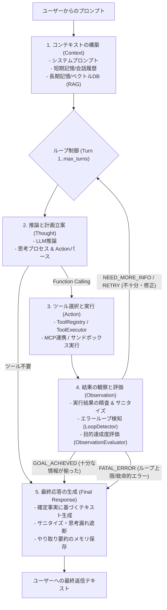

# 🎼 Agent Orchestrator (`harness.agent.orchestrator`)

AIエージェント・ハーネスアーキテクチャにおける **「1-2. オーケストレーター（フロー制御）」** を担当する統合エンジンです。

---

## 📖 概要 (Overview)

本パッケージは、ユーザーからのプロンプト受領から最終応答生成に至る**5段階の内部処理フロー**を統括・制御します。

### 階層ツリー構造における位置づけ

```text
AIエージェント・ハーネス（全体システム）
  1. 実行基盤（エージェント本体）
    1-1. プロンプトマネージャー(フェーズ1)＆パーサー(フェーズ2)  [harness/agent/prompt_parser]
    1-2. オーケストレーター（フロー制御 フェーズ1/2/3/4/5を制御）  [★本パッケージ: harness/agent/orchestrator]
       ├── 5段階フローの進行管理 (AgentOrchestrator)
       ├── コンテキスト構築・記憶引き出し連携
       ├── 推論・ツール実行・観察・再思考ループ
       └── 最終応答のサニタイズとメモリ保存
    1-3. メモリマネージャー(フェーズ1/4/5に関係)
    1-4. ツールレジストリ(フェーズ1/3に関係)                      [harness/agent/tool_registry]
    1-5. 結果の観察と評価(フェーズ4)                              [harness/agent/observation]
  2. テストハーネス（評価・安全性基盤）                           [harness/agent/test_harness]
```

---

## 🔄 5段階内部処理フローの実行パイプライン



---

## 💻 使用例 (Usage Example)

```python
from harness.agent.orchestrator import AgentOrchestrator, OrchestratorConfig
from harness.agent.tool_registry import get_default_registry

# 1. 設定とレジストリの準備
config = OrchestratorConfig(max_turns=3, think=False)
orchestrator = AgentOrchestrator(config=config, tool_registry=get_default_registry())

# 2. 5段階自律フローの実行
result = await orchestrator.run(
    user_prompt="明日の東京の天気を調べて教えてください。",
    system_prompt="あなたは親切なAIアシスタントです。",
    context={"memories": ["ユーザーは東京在住"]},
)

print(result.final_response)
print("実行ターン数:", result.total_turns)
print("観察件数:", len(result.observations))
```

---

## 🧩 主要モジュール構成

| モジュール | 主な役割・責務 |
| :--- | :--- |
| `engine.py` | 5段階推論・行動ループ（Context ➜ Thought ➜ Action ➜ Observation ➜ Final Response）のステートマシン制御。<br>コアシステムプロンプトの完全保護と予算超過時の `user_prompt` 優先トリミング（`<current_reply_target>` 保護）。<br>短文相槌時のWeb検索ゲーティングと対話相手名クエリの遮断。<br>最終応答後の全フロント共通行動台帳（`bot_activities`）への発話記録（`add_bot_activity`）。 |
| `loops.py` | 定期実行ループ（`agent_tick`, `reflection`, `topic`）と割り込み可能な背景LLMタスク管理。<br>ユーザー返信処理・感情更新中のビジー判定（`_is_user_reply_busy`）によるLLM推論競合抑止。<br>定期メンテナンスループ（`_reflection_loop`）における記憶減衰・パージおよび行動台帳レコードの定期自動パージ（`purge_bot_activities`、180日保持期限）。<br>モノローグクールダウン時の `boredom` 自発行動フォールスルー制御。 |
| `proactive.py` | 自発的トピック投稿、タイムライン巡回、文脈結合（`_build_proactive_channel_context_block`）、会話スレッド記録、および自発発話実行時の参照元背景情報のエピソード記憶（`memory_store.add_episode`）永続化。<br>§166 第4段階 自発発言の候補比較選定（`candidate_compare`）: `_generate_proactive_reply` 内で最大 `PROACTIVE_CANDIDATE_COUNT`（既定3）本の下書きを生成・`_sanitize_proactive_reply` 検証し、直近Bot発言との最大類似度が最小の候補を選んで投稿・台帳記録（`source_ref="stage4"`, `scope="proactive_discord"`、fail-open）。設定: `PROACTIVE_CANDIDATE_COMPARE_ENABLED`（既定 True）、`PROACTIVE_CANDIDATE_COUNT`（既定3）。本番確認ログ: `[CANDIDATE_COMPARE] scope=proactive_discord chosen=N total=M`。 |
| `reflection.py` | 定期内省（Deep Reflection）、ユーザー文化・信念の抽出・更新、話者名解決フォールバック、コルーチン安全クローズ（`safe_close_coroutine`）。<br>`num_predict` 指定によるリトライ防止と、助詞を含む対話相手名への主語正規化連携（`evaluate_deep_reflection_result` 通過）。 |
| `reflection_backoff.py` | §176 反省ループの同一材料再送遮断（失敗バックオフ、`ReflectionFailureTracker`）および通常反省・深い反省の system プロンプト末尾への JSON のみ出力サフィックス付加（`apply_json_only_suffix`）。<br>設定: `REFLECTION_JSON_ONLY_SUFFIX_ENABLED`（既定 True）、`REFLECTION_FAILURE_BACKOFF_ENABLED`（既定 True）。スキップ時ログ: `[REFLECTION_BACKOFF] skip unchanged failed target: ...`。 |
| `monologue.py` | 欲求駆動型の自律思考ループ（Inner Monologue）。<br>クールダウン事前判定（`is_inner_monologue_in_cooldown`）とスキップ理由ログ・感情減衰制御。 |
| `output_evaluation.py` | §156 Bot出力内容の背景評価（第1.5段階）。過去24時間の `bot_activities`（`reply` / `post`）を middle 系モデル（`OLLAMA_MIDDLE_MODEL`）で分類し、`kind="reply_eval"`（detail: `target_ref` / `target_kind` / `stance` / `labels`）として台帳に紐付け記録。`_reflection_loop` から `maybe_run_output_evaluation` で呼ばれ、会話継続中・返信中は見送り（fail-open）。<br>設定: `OUTPUT_EVAL_ENABLED`（既定 True）、`OUTPUT_EVAL_INTERVAL_SEC`（既定1800）、`OUTPUT_EVAL_MAX_PER_RUN`（既定10）、`OUTPUT_EVAL_TIMEOUT_SEC`（既定60）、`OUTPUT_EVAL_NUM_PREDICT`（既定256）。本番確認ログ: `[OUTPUT_EVAL] evaluated: count=N`。 |
| `lesson_extraction.py` | §158 第2段階 対照レッスンの抽出（`lesson`、改訂1）。過去 `LESSON_WINDOW_DAYS` 日（既定7日）の `gate_incident`/`gate_pass` および `detail.target_text` を持つ `reply_feedback`（`discord_reply`、負例: `negative`/`correction`/`incomprehension` 優先・正例: `positive` のみ、ゲート同一文重複排除、最大 `LESSON_FEEDBACK_MAX_EXAMPLES` 件）と `post_outcome` 最新スナップショット（`hutaba_post`）を対照し、middle 系モデル（`OLLAMA_MIDDLE_MODEL`）で一般的な教訓を抽出して `kind="lesson"`（`source_ref="stage2"`, detail: `scope` / `polarity` / `evidence_neg` / `evidence_pos` / `feedback_neg` / `feedback_pos` / `window_days`）として台帳へ保存。`_reflection_loop` から `maybe_run_lesson_extraction` で呼ばれ、会話継続中・返信中は見送り（fail-open、生成注入は第3段階）。<br>設定: `LESSON_EXTRACTION_ENABLED`（既定 True）、`LESSON_FEEDBACK_MATERIAL_ENABLED`（既定 True）、`LESSON_FEEDBACK_MAX_EXAMPLES`（既定10）、`LESSON_WINDOW_DAYS`（既定7）、`LESSON_MIN_EVIDENCE`（既定3）、`LESSON_MAX_PER_RUN`（既定3）、`LESSON_EXTRACT_INTERVAL_SEC`（既定86400）。本番確認ログ: `[LESSON] stored: scope=... polarity=... lesson=...`。 |
| `agent_mixin.py` | 上記のループ・自発発話・内省・モノローグMixinを1つに統合した `AgentOrchestrationMixin` の提供。 |
| `llm_client.py` | Ollama API 呼び出し抽象化とリトライ制御。 |

