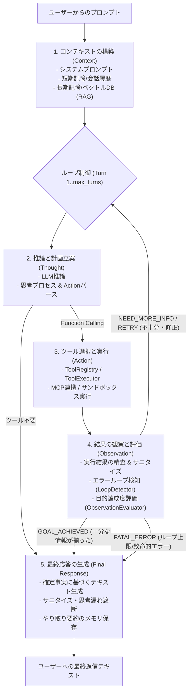

# 🎼 Agent Orchestrator (`harness.agent.orchestrator`)

AIエージェント・ハーネスアーキテクチャにおける **「1-2. オーケストレーター（フロー制御）」** を担当する統合エンジンです。

---

## 📖 概要 (Overview)

本パッケージは、ユーザーからのプロンプト受領から最終応答生成に至る**5段階の内部処理フロー**を統括・制御します。

### 階層ツリー構造における位置づけ

```text
AIエージェント・ハーネス（全体システム）
  1. 実行基盤（エージェント本体）
    1-1. プロンプトマネージャー(フェーズ1)＆パーサー(フェーズ2)  [harness/agent/prompt_parser]
    1-2. オーケストレーター（フロー制御 フェーズ1/2/3/4/5を制御）  [★本パッケージ: harness/agent/orchestrator]
       ├── 5段階フローの進行管理 (AgentOrchestrator)
       ├── コンテキスト構築・記憶引き出し連携
       ├── 推論・ツール実行・観察・再思考ループ
       └── 最終応答のサニタイズとメモリ保存
    1-3. メモリマネージャー(フェーズ1/4/5に関係)
    1-4. ツールレジストリ(フェーズ1/3に関係)                      [harness/agent/tool_registry]
    1-5. 結果の観察と評価(フェーズ4)                              [harness/agent/observation]
  2. テストハーネス（評価・安全性基盤）                           [harness/agent/test_harness]
```

---

## 🔄 5段階内部処理フローの実行パイプライン



---

## 💻 使用例 (Usage Example)

```python
from harness.agent.orchestrator import AgentOrchestrator, OrchestratorConfig
from harness.agent.tool_registry import get_default_registry

# 1. 設定とレジストリの準備
config = OrchestratorConfig(max_turns=3, think=False)
orchestrator = AgentOrchestrator(config=config, tool_registry=get_default_registry())

# 2. 5段階自律フローの実行
result = await orchestrator.run(
    user_prompt="明日の東京の天気を調べて教えてください。",
    system_prompt="あなたは親切なAIアシスタントです。",
    context={"memories": ["ユーザーは東京在住"]},
)

print(result.final_response)
print("実行ターン数:", result.total_turns)
print("観察件数:", len(result.observations))
```

---

## 🧩 主要モジュール構成

| モジュール | 主な役割・責務 |
| :--- | :--- |
| `engine.py` | 5段階推論・行動ループ（Context ➜ Thought ➜ Action ➜ Observation ➜ Final Response）のステートマシン制御。<br>コアシステムプロンプトの完全保護と予算超過時の `user_prompt` 優先トリミング（`<current_reply_target>` 保護）。<br>短文相槌時のWeb検索ゲーティングと対話相手名クエリの遮断。 |
| `loops.py` | 定期実行ループ（`agent_tick`, `reflection`, `topic`）と割り込み可能な背景LLMタスク管理。<br>ユーザー返信処理・感情更新中のビジー判定（`_is_user_reply_busy`）によるLLM推論競合抑止。<br>モノローグクールダウン時の `boredom` 自発行動フォールスルー制御。 |
| `proactive.py` | 自発的トピック投稿、タイムライン巡回、文脈結合（`_build_proactive_channel_context_block`）、会話スレッド記録、および自発発話実行時の参照元背景情報のエピソード記憶（`memory_store.add_episode`）永続化。 |
| `reflection.py` | 定期内省（Deep Reflection）、ユーザー文化・信念の抽出・更新、話者名解決フォールバック、コルーチン安全クローズ（`safe_close_coroutine`）。<br>`num_predict` 指定によるリトライ防止と、助詞を含む対話相手名への主語正規化連携（`evaluate_deep_reflection_result` 通過）。 |
| `monologue.py` | 欲求駆動型の自律思考ループ（Inner Monologue）。<br>クールダウン事前判定（`is_inner_monologue_in_cooldown`）とスキップ理由ログ・感情減衰制御。 |
| `agent_mixin.py` | 上記のループ・自発発話・内省・モノローグMixinを1つに統合した `AgentOrchestrationMixin` の提供。 |
| `llm_client.py` | Ollama API 呼び出し抽象化とリトライ制御。 |

