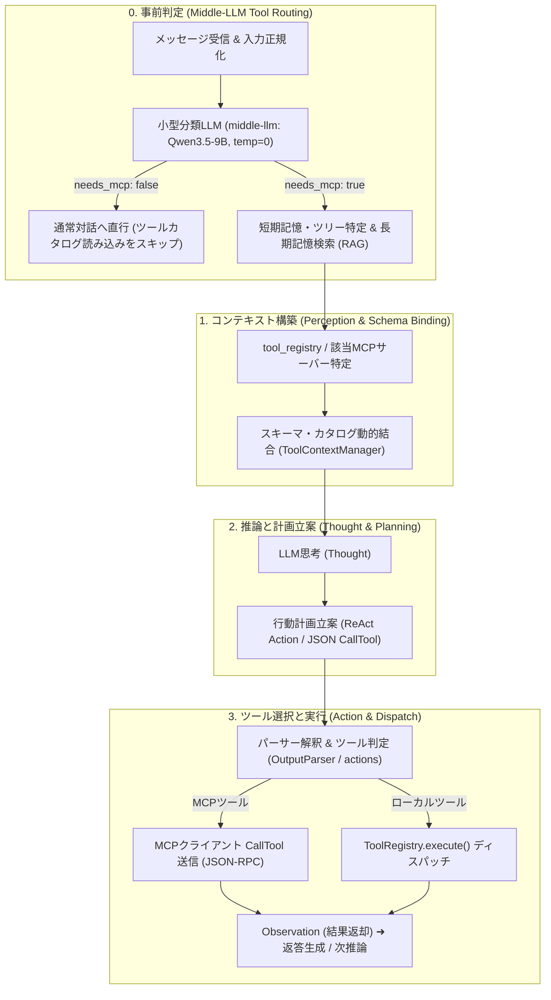

# 🧩 Prompt Manager & Output Parser (`harness.agent.prompt_parser`)

Discord AI Bot における「プロンプト生成・結合（PromptManager）」および「LLM出力検証・思考サニタイズ（OutputParser）」を担当する独立ハーネスコアパッケージです。

---

## 📖 概要 (Overview)

本パッケージは、Discord特有のマルチユーザー並行対話、返信ツリー文脈、感情・関係値、長期記憶（RAG）、外部Web調査結果を安全に集約・構造化し、小型〜中型推論モデル（Qwen系等）が安定して破綻のないセリフを出力できるようにするための**多重防御アーキテクチャ**を提供します。

### 主な役割
1. **プロンプト動的構築 (`prompt_manager`)**:
   - 返信ツリー親メッセージ（`latest_ref`）を最優先文脈として保護（目的語ハイジャック防止）。
   - 事前分析エージェント（Middle-LLM / Analyzer）による意図判定、記憶選別、自己整合性監査、および画像調査質問（「これ誰？」「何の画像？」等）の的確な検知（`target_is_ai=True, intent='質問', external_research=True`）。さらに `intent_info` に調査判定（`research_decision`: `{should_research, mode, search_query}`）を同梱し、後段でのLLM二重呼び出しを防止。
   - キャラクター人格、日時、感情温度感、行動ルール、および【調査思考ポリシー】（`search_web` / `search_image` ツール呼び出し指示）を動的に結合するシステムプロンプト生成。
   - トークン予算管理（Budget）による重要文脈の保護と段階的トリミング（1: 並行スレッド一覧 → 2: 習慣プロファイル・関心事 → 3: 会話要約 → 3.5: 重複固定ルール圧縮ノート化 → 4: 会話履歴（`protected_lines` 保護） → 5: ツールカタログ → 6: 長期記憶候補）。
   - 作業記憶（Working Memory）の動的再構成および特定想起判定（`needs_specific_recall`）における内容確認フレーズ（「どんな内容」「何の内容」「どんな話」「何の話」「どういう話」「何のこと」等）サポートによるエピソード記憶想起トリガー。
   - 英数字キーワード（`NAI`, `novelai`, `ComfyUI`, `Muse`, `Gemini`, `pixai`, `LoRA` 等）抽出および略称同義語展開（`_expand_topic_synonyms`）による先行アクティブスレッドへの再合流（Re-attachment）、単発割り込み話題とのキメラ `topic_origin` 合成防止（`_sanitize_interleaved_tangent_topic_origin`）、および未完結な話題切り出し短文（「〇〇さあ」等）における直後連投の同一話者バースト統合（`_collect_same_author_burst_continuation_texts`）。
   - 調査用プロンプト（`build_research_reply_base_prompt`）において、返信元がBot自身（`あなたの「...」への返信`）である場合に、自発言に対する返事・キャッチボールとして解釈させる返信元コンテキスト分岐。
   - AI認定・コピペ煽りへのメタ自白厳禁とキャラクター反論（等身大に否定・ツッコミを返し実体感を死守）、動画（mp4等）や未解析添付ファイルへの知ったかぶり・情景捏造抑止、および他作品ミーム混線防止（ワードサラダ抑止）の共通防衛ルール。
   - 否定済み主張レジストリ（`denied_claims.py`）による文脈注釈と、プロンプトへの再主張禁止リスト描画。直前の誤り訂正指示（短く認めて謝罪、言い訳厳禁、再主張禁止）および作業記憶からの会話状態メモ（`working_context["conversation_state"]`: 話題・確定事実・否定内容・未解決の問い・相手の様子）の描画。
2. **掲示板プロンプト基盤 (`board_prompts.py`)**:
   - ふたば☆ちゃんねる（img/may）等のスレッド要約整形（`format_img_thread_summary`）および投稿プロンプト生成（`build_img_thread_post_prompt`）。スレッドURLやboard指定に基づく動的ドメイン解決（`_resolve_hutaba_board_domain`）により `img.2chan.net` / `may.2chan.net` 両サーバーに完全対応。
   - スレッド書き込み後の感情・理由作文プロンプト（`build_hutaba_post_emotion_prompt`, `build_hutaba_post_emotion_system_prompt`）およびJSONスキーマ（`HUTABA_POST_EMOTION_SCHEMA`）の提供。機械的テンプレート文（「〜スレでとしあきと掛け合いして楽しかった。」等）を完全禁止し、スレッドの話題・としあきの発言・自レスの内容を踏まえた25〜70文字の具体的かつ自然な理由文作文を制御。
   - 本文テキスト引用（`>文字列`）の逆引き解決（`find_img_thread_quoted_posts`）により、レスヘッダーに親子関係ラベル（`[>>XX への返信]` / `[スレッド全体への独立発言（直前レスへの返信ではない）]` / `[スレ画・定型への独立引用]`）を自動付与してフラットな時系列誤読（Recency Bias）を防止。
   - スレッド全体の大きな流れや支配的トピックを伝えるマクロ話題遷移要約（`macro_topic_summary`）の注入セクション対応。
   - スレッド内の引用（`>`）・アンカー（`>>`）から各レスの被返信数を全表記揺れ（`post_no` / `No.post_no` / `number`）に対応して集計（`calculate_img_thread_reply_counts`）し、レスヘッダーに `[返信:N件]` を付与。被返信数が0で引用を持たない孤立レスには `[独立発言・返信非推奨]` ラベルを明記し、LLMが直近の孤立発言へ誤反応するのを防止。
   - 直近レスが引用している親レス（被返信ありのホットな話題起点）を抽出した `--- 直近で返信がついている注目の会話レス（返信先候補） ---` を要約に明示し、直近レスが枠外のレスに集中している場合でもLLMが話題の起点を正しく選べるように支援。
   - 進行中スレッド（10レス以上）において引用強制・空配列逃げ道完全撤廃ルール（`【進行中スレッドの引用必須・返信先選択ルール】`）を指示し、OP単体への引用なしレス（単独投稿）や `quote_post_numbers` の空配列 `[]`、`[独立発言・返信非推奨]` レスへの返信を厳禁化。必ず【直近で返信がついている注目の会話レス】から返信対象レス番号を1件選択させることでプロンプト自己矛盾と孤立レス誤反応を根絶。
   - メタ逃げ禁止（「置いてけぼり」「急に〇〇と言われても分からない」等）、独立発言へのキメラ合成厳禁、およびスレタイと中身の乖離（看板詐欺・話題乗っ取り）に対する構図共感ルールの徹底。
   - 修辞的疑問（〇〇はどう思う？形式）に対する代弁ボケ（著名人・第三者になりきった傲慢な一言）やスレ内ミーム・定型句（『黙れ〇〇！』等）での大喜利返し許可、大喜利投下時におけるペルソナスイッチング（切れ味優先でのペルソナ語尾減衰）、およびキメラ返信禁止ルールの明確化（無関係な話題合成は禁止だが周囲のツッコミのノリや風刺ミームの活用は推奨）。
   - 本文引用（`>`）のないレスに対し、直前最大8レスを走査してトピック語・略称同義語（`_extract_img_post_topic_tokens` / `_expand_topic_synonyms`）が一致する先行レスを暗黙文脈として探索・結合（`build_img_thread_reply_context_chain`）。共通トピック語が見つからない場合であっても直前1レス（`posts[cutoff - 1]`）がOPでない限り `_is_implicit_context = True` としてフォールバック保持し、文脈喪失（`(抽出できず)`）を防止（BAN-169, BAN-171）。暗黙文脈採用時のラベル分離（`このレスと同じ話題の先行レス（引用なし・参考文脈）`）と合体キメラ返信厳禁ルールの徹底。
   - 引用返信プロンプト（`build_img_thread_followup_post_prompt`）への `target_context_lines`（対象レスの周辺文脈）注入対応、およびHook Echo（文頭フレーズ反復＋抽象ポエム）厳禁・ネットスラング（プロレス等）誤読防止・カウンター思考ルールの徹底。
   - `build_img_thread_followup_post_prompt` において、`quoted_own_posts` が空または `None` の場合（初回巡回時などに進行中スレッドの注目レスへ引用参加するケース）に「あなたが前に書いたレス」等の虚偽文脈を出力せず、「スレッド内で盛り上がっている以下の注目レスに対して、引用（>）をつけて会話に参加します。」および「返信対象の注目レス:」に切り替える初回注目レス引用参加モードの提供。
   - 掲示板プロンプト（`build_img_thread_post_system_prompt` 等）における中国語（簡体字や『劲儿』『这』『那』『们』『吗』等の中国語語彙）混入の絶対禁止（一般的な英単語・アルファベット略称は使用可）。
   - AI認定・Bot認定煽りへのメタ自白厳禁とキャラクター反論（実体感死守）、メディア解析情報への準拠と未解析メディアの知ったかぶり・情景捏造厳禁、無関係な他作品ミーム混線（ワードサラダ）禁止、および文頭オウム返し（Hook Echo）排除ルールの徹底。
   - 既出ツッコミ・回答の語尾変えパクり（言い換え盗用）および複数レス合体キメラの絶対厳禁ルール（スレッド内や【対象レスの周辺文脈】で他のとしあきが既に書いたツッコミ・回答・数字を語尾だけ変えて繰り返したり、複数レスを繋ぎ合わせて自分の発言のように出力することを厳禁とし、既出内容は消費済みとして除外し別視点・背景理由からリアクションさせる方針）、および被返信集計における孫引用の多重カウント防止（`max_targets=1` による直系1件限定）。
   - システムプロンプト（`build_img_thread_post_system_prompt`）とユーザープロンプト（`build_img_thread_post_prompt`, `build_img_thread_followup_post_prompt`）の重複長文ルール圧縮・整理。システムプロンプト側は役割定義・人格口調反映・3段階推論（Step A: 文脈把握、Step B: カウンター方針、Step C: サニタイズ）・JSON出力順序（`thought` 先行出力）に集中させ、細かな禁止事項をユーザープロンプト側に集約してトートロジーへの退行を抑止しつつ推論を高速化。
   - 【引用と本文の分離ルール】によるJSONの `comment` フィールドへの非アンカー引用行（`>本文`）やアンカー（`>>No.`）自前書き込みの完全禁止。アンカー自動付与に伴う `quote_post_numbers` / `quote_reply_numbers` の空配列 `[]` 設定、および周辺文脈のメタ実況禁止（『みんな〜って言ってる』等）の徹底。
3. **LLM出力検証・サニタイズ (`parser`)**:
   - 推論モデルの思考タグ（`<think>`）の漏洩防止および未完思考ブロックからのセリフ救出（サルベージ）。
   - 話者名付きエコー行、プロンプト指示文の引き写し、制御行の除去。
   - オウム返し、前発言丸コピペ、外国語混入、文末途切れ（`done_reason=length`）の多層安全性検証。
   - 簡体字・中国語固有語彙（『劲儿』『这』『那』『们』『吗』『吧』等）の混入検知（`contains_chinese_leak` / `looks_like_non_japanese_reply`）による再推論リトライ、およびサニタイズ（`sanitize_chinese_leak` / `sanitize_generated_reply`）による『〜劲儿』→『〜っぷり』等の自然な日本語表現への自動置換・簡体字変換（一般的な英単語・アルファベット表記は許容）。
   - Hook Echo（文頭フレーズ反復＋抽象感想・懐古ポエム）検知（`looks_like_parrot_reply`）によるトピック受容すり抜け遮断。
   - 会話履歴（`context_lines`）内の他ユーザー発言盗用・パッチワーク合体検知（`looks_like_context_peer_plagiarism`）とオウム返しリトライプロンプト（`build_parrot_retry_prompt`）連携によるキメラ返信の自動再生成・多層防護。文脈行先頭のタイムスタンプ（`[HH:MM]`）や関係ラベル（`(独立発言)` / `[>>...]` 等）の事前除去により、Bot自身の直前発言やSystemメモの他者発言誤認・誤検知を完全排除。
   - 他ユーザー宛て返信への応答における自分宛て誤認・被害的困惑・無知表明検知（`looks_like_misdirected_confusion_reply`、却下ラベル `misdirected confusion`）と外野ツッコミ再生成リトライ（`build_misdirected_confusion_retry_prompt`）。Bot宛て返信では不発動。
   - 構造化JSON呼び出し（スキーマ検証、配列件数上限 `maxItems`、反復ペナルティ `repeat_penalty`）。
   - 特定キャラクター名に依存しない汎用的な一人称ガード（`reply_guards.py`, `validation.py`）およびAIメタ発言サニタイズ（`cleaner.py` の `sanitize_ai_meta_statements`）。設定された一人称（`BOT_FIRST_PERSON`）を動的に反映し、未設定・未指定時は自然な主語省略表現へ安全にフォールバック。
   - プロンプトマネージャー（`system_prompts.py`, `analysis_prompts.py`, `board_prompts.py`, `retry_prompts.py`, `builder.py`）内のNG例文・説明文における特定キャラ名ハードコードの排除と汎用設計。

### 事前分析戻り値仕様 (`intent_info`)
`analyzer.py` の `_analyze_pre_reply_context` が返却する `intent_info: dict[str, Any]` の主なキー構造：
- `intent`: 意図種別（例: `雑談`, `質問`, `依頼`, `ツッコミ`, `ボケ`, `確認` など）
- `target_is_ai`: 発言がAI自身に向けられたものか（`bool`）
- `should_clarify`: 意味不明で聞き返しが必要か（`bool`）
- `needs_reasoning`: 論理的推論や深い思考が必要か（`bool`, オプショナル）
- `research_decision`: 事前分析LLMによる外部調査判定（`Optional[dict[str, Any]]`）
  ```python
  {
      "should_research": bool,  # 外部調査が必要か
      "mode": str,              # "none" | "simple_search" | "browser_search" | "image_search" | "img_thread"
      "search_query": str,      # 調査クエリ（最大100文字、不要時は ""）
  }
  ```
  - 事前分析で調査不要と判定された場合は `{"should_research": False, "mode": "none", "search_query": ""}`
  - スキップ時（カジュアル挨拶・相槌）は `{"should_research": False, "mode": "none", "search_query": ""}`
  - 判定不能・LLM未出力・エラーフォールバック時は `None`
  - 後段の調査判定モデル二重呼び出しを抑止しつつ、BAN-115/141/168 多重防御ガードにより意見募集等の文脈での調査保護を両立。
- `user_correction`: ユーザーによるBot発言の誤り否定・訂正検出（`Optional[dict[str, Any]]`）
  ```python
  {
      "is_correction": bool,    # 訂正発言か（『違う』『言ってない』など明示的な否定時のみ True）
      "retracted_claim": str,  # 否定されたBotの主張（最大80文字）
      "corrected_fact": str,   # ユーザーが示した正しい内容（最大80文字、無ければ空文字）
  }
  ```
  - 検出時は否定済み主張レジストリ（`denied_claims.py`）へ即時登録され、TTL・件数制限下で文脈注釈および再主張禁止リストとして機能。
  - 非訂正時（単なる意見の相違・好みの表明・新話題など）やLLMスキップ時は `None`。

### 固有名詞グラウンディング・サニタイズユーティリティ
比較・比喩構文（「〜の二番煎じ」「〜選手みたい」「〜級の」等）における架空人物名・外国人名の捏造を決定論的に防止するユーティリティ群：
- `find_ungrounded_person_names(comment, allowed_terms, *, stopwords=None, persona_names=None) -> list[str]`:
  生成文から、コンテキスト（`allowed_terms`）に存在しない中黒連結カタカナ名（パターンA）や人物文脈（選手・投手・監督等）と共起する未グラウンディングカタカナ語（パターンB）を決定論的に検出。
- `strip_ungrounded_person_sentences(text, ungrounded_names) -> str`:
  未グラウンディング人名を含む文のみを句点・改行単位で除去し、正常文を保持・再結合してサニタイズ。
- `build_anti_name_hallucination_retry_prompt(base_prompt, names) -> str`:
  検出された架空人物名を明示し、名前を出さずに描写・特徴のみでの再生成を促すリトライプロンプトを構築。

---

## 📁 ディレクトリ構成 (Package Structure)

```text
harness/agent/prompt_parser/
├── __init__.py                # 公開APIエクスポート（PromptManager, OutputParser, call_ollama_json等）
├── AGENTS.md                  # 開発・運用ガイドライン（正本）
├── GEMINI.md                  # AIエージェント向けエントリポイント
├── README.md                  # 本ドキュメント
├── prompt_manager/            # プロンプト生成・分析・結合層
│   ├── __init__.py            # PromptManager ファサード
│   ├── builder.py             # ユーザープロンプト動的生成、トピック引きずり防止、エコー行除去
│   ├── analyzer.py            # Middle-LLM 事前分析（意図、メモリ選別、内省、整合性監査）
│   ├── analysis_prompts.py    # 事前分析用システムプロンプト（9項目判定スキーマ）
│   ├── denied_claims.py       # 否定済み主張レジストリ・文脈注釈ユーティリティ
│   ├── board_prompts.py       # 掲示板（ふたば☆ちゃんねる img/may）投稿・返信プロンプト、感情理由作文、スレッド要約・被返信集計
│   ├── system_prompts.py      # システムプロンプト動的生成（通常返信、ファクトチェック、調査等）
│   ├── analysis_prompts.py    # 事前分析用システムプロンプト・ユーザープロンプト定義
│   ├── retry_prompts.py       # リトライ用スリム化プロンプト生成（直前のAI発言や話題の起点・背景を保持した文脈迷子防止）
│   ├── budget.py              # トークン予算管理、コンテキスト行トリム
│   ├── thread_tracker.py      # 返信ツリー・並行スレッド追跡、英数字・同義語キーワードによる先行スレッド再合流（Re-attachment）、短文話題切り出し分離
│   ├── working_memory.py      # 作業記憶の毎ターン再構成・特定想起判定（needs_specific_recall）
│   └── tool_context.py        # ツールカタログ生成・MCP動的同期・スキーマ結合
└── parser/                    # LLM出力パース・サニタイズ層
    ├── __init__.py            # OutputParser ファサード
    ├── cleaner.py             # 思考タグ・マークダウン・制御行・エコー行のサニタイズ
    ├── salvage.py             # 未完思考ブロックからのセリフ救出
    ├── control.py             # 不知・理解不能返答のスキップ判定（should_skip_unknown_reply）
    ├── patterns.py            # プロンプト漏洩、思考漏洩、エコー行検知パターン
    ├── validation.py          # オウム返し、前発言酷似、キャラ崩壊等の多層検証
    ├── structured.py          # JSONスキーマ検証付き構造化LLM呼び出し（call_ollama_json）
    └── actions.py             # ReAct/JSONツール呼び出しパース、MCP CallTool送信・実行ディスパッチ
```

---

## 🔄 プロンプト処理 & エージェント推論・行動ループ (Agent Architecture)

本パッケージは、Discordメッセージへの直接返信に加え、外部MCPサーバーおよびツールレジストリと連携した**3段階のエージェント推論・行動ループ**を完全サポートします。



### 3段階ループの責務と詳細フロー

0. **フェーズ0: 小型分類LLMによるMCP利用要否・種別判定（Tool Routing Gate）**
   - メイン対話モデルに常時全ツールの長大なスキーマを読ませるオーバーヘッド（トークン浪費・30秒以上のレイテンシ）や誤爆を防ぐため、前段で軽量・高速な分類専用モデル（`middle-llm:latest`、Qwen3.5-9B、`temperature: 0`、`num_predict: 256`）がMCPツール利用要否（`needs_mcp`）を決定論的に分類。
   - `needs_mcp=false`（日常雑談、共感、相槌、内輪の話題）の場合はツールカタログをプロンプトに注入せず、通常のキャラクター対話へ直行。
   - `needs_mcp=true`（天気照会、URL読解、最新ニュース調査など）の場合のみ、該当するMCPツール群を後続パイプラインに動的バインド。
1. **フェーズ1: コンテキストの構築（知覚・記憶の引き出し & ツールカタログ結合）**
   - ユーザー入力、過去の会話履歴、MemoryStore（RAG）からの長期記憶に加え、`harness/agent/tool_registry` および外部MCPサーバー（`tool_registry/mcp`）から「現在利用可能なツールの説明書（スキーマ・引数）」を動的に取得。
   - `ToolContextManager.bind_to_system_prompt()` により、プロンプト末尾にツール定義と計画立案ガイドライン（Thought & Planning ガイド）を注入。
2. **フェーズ2: 推論と計画立案（Thought & Planning）**
   - 記憶とツールカタログを元に、LLMが「目的を達成するために今何をすべきか」を思考（`<think>` / `Thought:`）。
   - 外部情報が必要と判断した場合、カタログから適切なツールを選定し、具体的な引数とともにツール呼び出し計画（JSONブロック `{"tool": "...", "arguments": {...}}` または ReAct形式）を出力。
3. **フェーズ3: ツール選択と実行（Action & MCP Dispatch）**
   - `OutputParser.parse_tool_calls()` がLLM出力から思考・ツール呼び出し指示・ユーザー向け返答テキストを分離・抽出。
   - `OutputParser.is_mcp_tool()` により指示されたツールがMCP経由かを解釈。
   - MCPツールの場合はMCPクライアントを介して対象MCPサーバーへ JSON-RPC `call_tool(name, arguments)` を送信。
   - サーバー側で実際の処理が行われ、その結果がエージェントに Observation（`ToolResult`）として返却され、次の対話や最終返答に反映。

---

## 🛠️ 開発・テスト・品質基準 (Guidelines & Testing)

本パッケージでの開発にあたっては、以下の規約を厳守してください：

1. **ログ接頭辞の徹底**:
   - プロンプト生成、分析、サニタイズ、スキーマ検証の全処理において、`[prompt-manager]` をプレフィックスとした統一ログを出力してください。
2. **50KBルールの遵守**:
   - 各ソースファイルは原則 50KB 未満を維持し、単一責任原則に従って適切に分割・管理してください。
3. **静的型検査 (mypy)**:
   - Python 3.11+ 型アノテーションを完全に付与し、`mypy` 検査でエラー 0 件を維持してください。
   ```bash
   mypy harness/agent/prompt_parser
   ```
