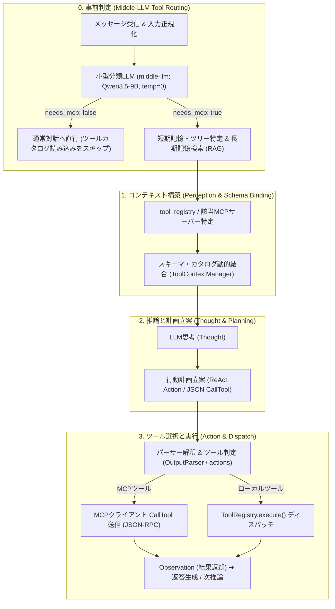

# 🧩 Prompt Manager & Output Parser (`harness.agent.prompt_parser`)

Discord AI Bot における「プロンプト生成・結合（PromptManager）」および「LLM出力検証・思考サニタイズ（OutputParser）」を担当する独立ハーネスコアパッケージです。

---

## 📖 概要 (Overview)

本パッケージは、Discord特有のマルチユーザー並行対話、返信ツリー文脈、感情・関係値、長期記憶（RAG）、外部Web調査結果を安全に集約・構造化し、小型〜中型推論モデル（Qwen系等）が安定して破綻のないセリフを出力できるようにするための**多重防御アーキテクチャ**を提供します。

### 主な役割
1. **プロンプト動的構築 (`prompt_manager`)**:
   - 返信ツリー親メッセージ（`latest_ref`）を最優先文脈として保護（目的語ハイジャック防止）。
   - 事前分析エージェント（Middle-LLM / Analyzer）による意図判定、記憶選別、自己整合性監査。
   - キャラクター人格、日時、感情温度感、行動ルールを動的に結合するシステムプロンプト生成。
   - トークン予算管理（Budget）による重要文脈の保護と安全な切り詰め。
2. **LLM出力検証・サニタイズ (`parser`)**:
   - 推論モデルの思考タグ（`<think>`）の漏洩防止および未完思考ブロックからのセリフ救出（サルベージ）。
   - 話者名付きエコー行、プロンプト指示文の引き写し、制御行の除去。
   - オウム返し、前発言丸コピペ、外国語混入、文末途切れ（`done_reason=length`）の多層安全性検証。
   - 構造化JSON呼び出し（スキーマ検証、配列件数上限 `maxItems`、反復ペナルティ `repeat_penalty`）。

---

## 📁 ディレクトリ構成 (Package Structure)

```text
harness/agent/prompt_parser/
├── __init__.py                # 公開APIエクスポート（PromptManager, OutputParser, call_ollama_json等）
├── AGENTS.md                  # 開発・運用ガイドライン（正本）
├── GEMINI.md                  # AIエージェント向けエントリポイント
├── README.md                  # 本ドキュメント
├── .agents/                   # ガイドライン・禁止事項ルールセット
│   └── rules/
│       ├── principles.md      # 設計前提・コア開発原則
│       └── ban_list.md        # バグ再発防止ナレッジ（全103項目）
├── prompt_manager/            # プロンプト生成・分析・結合層
│   ├── __init__.py            # PromptManager ファサード
│   ├── builder.py             # ユーザープロンプト動的生成、トピック引きずり防止、エコー行除去
│   ├── analyzer.py            # Middle-LLM 事前分析（意図、メモリ選別、内省、整合性監査）
│   ├── system_prompts.py      # システムプロンプト動的生成（通常返信、ファクトチェック、調査等）
│   ├── analysis_prompts.py    # 事前分析用システムプロンプト・ユーザープロンプト定義
│   ├── retry_prompts.py       # リトライ用スリム化プロンプト生成
│   ├── budget.py              # トークン予算管理、コンテキスト行トリム
│   ├── thread_tracker.py      # 返信ツリー文脈追跡
│   └── tool_context.py        # ツールカタログ生成・MCP動的同期・スキーマ結合
└── parser/                    # LLM出力パース・サニタイズ層
    ├── __init__.py            # OutputParser ファサード
    ├── cleaner.py             # 思考タグ・マークダウン・制御行・エコー行のサニタイズ
    ├── salvage.py             # 未完思考ブロックからのセリフ救出
    ├── control.py             # 不知・理解不能返答のスキップ判定（should_skip_unknown_reply）
    ├── patterns.py            # プロンプト漏洩、思考漏洩、エコー行検知パターン
    ├── validation.py          # オウム返し、前発言酷似、キャラ崩壊等の多層検証
    ├── structured.py          # JSONスキーマ検証付き構造化LLM呼び出し（call_ollama_json）
    └── actions.py             # ReAct/JSONツール呼び出しパース、MCP CallTool送信・実行ディスパッチ
```

---

## 🔄 プロンプト処理 & エージェント推論・行動ループ (Agent Architecture)

本パッケージは、Discordメッセージへの直接返信に加え、外部MCPサーバーおよびツールレジストリと連携した**3段階のエージェント推論・行動ループ**を完全サポートします。



### 3段階ループの責務と詳細フロー

0. **フェーズ0: 小型分類LLMによるMCP利用要否・種別判定（Tool Routing Gate）**
   - メイン対話モデルに常時全ツールの長大なスキーマを読ませるオーバーヘッド（トークン浪費・30秒以上のレイテンシ）や誤爆を防ぐため、前段で軽量・高速な分類専用モデル（`middle-llm:latest`、Qwen3.5-9B、`temperature: 0`、`num_predict: 256`）がMCPツール利用要否（`needs_mcp`）を決定論的に分類。
   - `needs_mcp=false`（日常雑談、共感、相槌、内輪の話題）の場合はツールカタログをプロンプトに注入せず、通常のキャラクター対話へ直行。
   - `needs_mcp=true`（天気照会、URL読解、最新ニュース調査など）の場合のみ、該当するMCPツール群を後続パイプラインに動的バインド。
1. **フェーズ1: コンテキストの構築（知覚・記憶の引き出し & ツールカタログ結合）**
   - ユーザー入力、過去の会話履歴、MemoryStore（RAG）からの長期記憶に加え、`harness/agent/tool_registry` および外部MCPサーバー（`tool_registry/mcp`）から「現在利用可能なツールの説明書（スキーマ・引数）」を動的に取得。
   - `ToolContextManager.bind_to_system_prompt()` により、プロンプト末尾にツール定義と計画立案ガイドライン（Thought & Planning ガイド）を注入。
2. **フェーズ2: 推論と計画立案（Thought & Planning）**
   - 記憶とツールカタログを元に、LLMが「目的を達成するために今何をすべきか」を思考（`<think>` / `Thought:`）。
   - 外部情報が必要と判断した場合、カタログから適切なツールを選定し、具体的な引数とともにツール呼び出し計画（JSONブロック `{"tool": "...", "arguments": {...}}` または ReAct形式）を出力。
3. **フェーズ3: ツール選択と実行（Action & MCP Dispatch）**
   - `OutputParser.parse_tool_calls()` がLLM出力から思考・ツール呼び出し指示・ユーザー向け返答テキストを分離・抽出。
   - `OutputParser.is_mcp_tool()` により指示されたツールがMCP経由かを解釈。
   - MCPツールの場合はMCPクライアントを介して対象MCPサーバーへ JSON-RPC `call_tool(name, arguments)` を送信。
   - サーバー側で実際の処理が行われ、その結果がエージェントに Observation（`ToolResult`）として返却され、次の対話や最終返答に反映。

---

## 🛠️ 開発・テスト・品質基準 (Guidelines & Testing)

本パッケージでの開発にあたっては、以下の規約を厳守してください：

1. **ログ接頭辞の徹底**:
   - プロンプト生成、分析、サニタイズ、スキーマ検証の全処理において、`[prompt-manager]` をプレフィックスとした統一ログを出力してください。
2. **50KBルールの遵守**:
   - 各ソースファイルは原則 50KB 未満を維持し、単一責任原則に従って適切に分割・管理してください。
3. **静的型検査 (mypy)**:
   - Python 3.11+ 型アノテーションを完全に付与し、`mypy` 検査でエラー 0 件を維持してください。
   ```bash
   mypy harness/agent/prompt_parser
   ```
4. **テストの実行**:
   - プロジェクトルートから以下のテストを実行して ALL GREEN を確認してください。
   ```bash
   PYTHONPATH=. pytest tests/test_harness_prompt_parser.py tests/test_chat_prompt_logic.py
   ```
