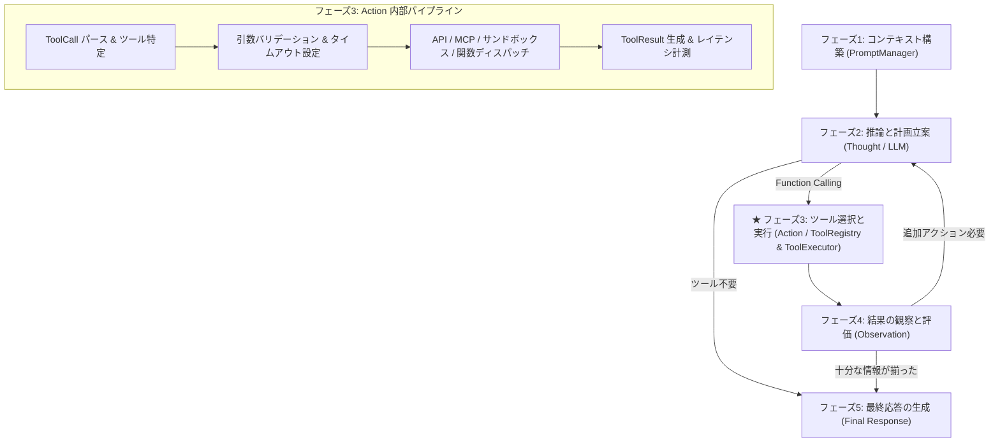

# 🛠️ Tool Registry & Action Execution (`harness.agent.tool_registry`)

Discord AI Bot における「ツールカタログ・スキーマ管理（ToolRegistry）」および「ツール選択と実行（Action / ToolExecutor）」を担当する独立ハーネスコアパッケージです。

---

## 📖 概要 (Overview)

本パッケージは、AIエージェント・ハーネスアーキテクチャの **「1-4. ツールレジストリ（フェーズ1/3に関係）」** および **「フェーズ3. ツール選択と実行（Action）」** を具現化するコンポーネントです。

LLM（推論エンジン）が外部環境と安全に干渉するための基盤として、利用可能なツールのカタログ管理、OpenAI/Ollama互換の Function Calling スキーマ生成、実処理への非同期ルーティング、タイムアウト制御、外部プロトコル（MCP / Web / 天気）連携を提供します。

### 階層ツリー構造における位置づけ

```text
AIエージェント・ハーネス（全体システム）
  1. 実行基盤（エージェント本体）
    1-1. プロンプトマネージャー(フェーズ1)＆パーサー(フェーズ2)  [harness/agent/prompt_parser]
    1-2. オーケストレーター（フロー制御 フェーズ1/2/3/4/5を制御）
    1-3. メモリマネージャー(フェーズ1/4/5に関係)
    1-4. ツールレジストリ(フェーズ1/3に関係)                      [★本パッケージ: harness/agent/tool_registry]
       ├── 利用可能なツールカタログ（スキーマ）の管理
       ├── Function Callingの実処理へのルーティング
       └── 外部プロトコル連携（MCPやOpenAPI、Web、Weather）
  2. テストハーネス（評価・安全性基盤）
```

### 主な役割
1. **ツールカタログ・スキーマ管理 (`registry.py`, `types.py`)**:
   - `ToolDefinition`, `ToolParameter` によるスキーマの厳格な型定義。
   - OpenAI / Ollama 互換の Function Calling スキーマ（`get_schemas()`）動的エクスポート。
   - カテゴリ別（WEB, MCP, WEATHER, SYSTEM, CUSTOM）やタグ別のフィルタリング、有効化/無効化制御。
2. **Action 実行・ルーティングエンジン (`executor.py`)**:
   - LLMからの `ToolCall` に対する引数バリデーション（必須パラメータ・Enumチェック）。
   - 同期・非同期（`async`）関数の透過的ディスパッチとタイムアウト制御（`asyncio.wait_for`）。
   - 多重防御・包括的例外捕捉（クラッシュを防止し `ToolResult(success=False, error=...)` を安全に返却）。
   - フェーズ4（Observation）入力用の標準フォーマット（`to_observation_message()`）。
   - 統一ログ接頭辞 `[tool_registry]` の出力と実行時間（レイテンシ）の計測。
3. **外部プロトコル・ビルトイン連携 (`adapters/`)**:
   - **Web検索アダプター (`web_search.py`)**: ネット調査・ブラウジング機能をラップ。
   - **バッチリサーチツールアダプター (`web_run.py`)**: OpenAI Codex の `web.run` を参考にした独立型バッチリサーチツール。検索・開く・ページ内検索のコマンド束ね実行、参照ID（s0, p0等）、行番号付きページ表示、および `response_length`（short/medium/long）出力量制御を提供。
   - **ページレジストリ (`web_research/page_registry.py`)**: `web_run` 用のメモリ内ページ・検索結果保持レジストリ。FIFO上限（ページ20件・検索結果40件、1ページ最大60,000字）および最終アクセスから30分の自動期限切れ掃除を完備。
   - **画像検索アダプター (`image_search.py`)**: 専用逆画像検索API（SauceNAO / trace.moe）並行呼び出し＋自前ビジョン検証連携による高精度な逆画像検索（キャラクター・人物・作品名・元ネタ・出典特定）機能をラップ。trace.moe での `anilistInfo=1` パラメータ付与・タイトル取得、タイトル空候補の除外、自前ビジョン検証による未検証候補の格下げ（特定結果誤認識防止）、正直な特定結果生成（特定不能時の「特定できませんでした」明記）、未検証注記、および `[IMAGE_SEARCH]` 構造化観測ログを完備。
   - **天気情報アダプター (`weather.py`)**: 国内気象情報 MCP（気象庁 JMA & ウェザーニュース）と連携し、地域気象データ・公式予報取得機能をラップ。
   - **MCPアダプター (`mcp.py`)**: Model Context Protocol（Chrome MCP等）から動的にツールをインポート。
4. **宣言的デコレータ (`decorators.py`)**:
   - `@tool` デコレータによるPython関数の自動カタログ化・レジストリ登録。

---

## 📁 ディレクトリ構成 (Package Structure)

```text
harness/agent/tool_registry/
├── __init__.py                # 公開APIエクスポート（ToolRegistry, ToolExecutor, tool等）
├── AGENTS.md                  # 開発・運用ガイドライン（正本）
├── GEMINI.md                  # AIエージェント向けエントリポイント
├── README.md                  # 本ドキュメント
├── types.py                   # ツール定義、パラメータ、ToolCall、ToolResult型
├── registry.py                # ツールカタログ管理（ToolRegistry）
├── executor.py                # Action実行エンジン・ルーティング（ToolExecutor）
├── decorators.py              # @tool デコレータおよびグローバルレジストリ
├── adapters/                  # 外部プロトコル・ビルトイン連携アダプター
│   ├── __init__.py
│   ├── image_search.py        # 逆画像検索ツール（SauceNAO / trace.moe / ビジョン検証連携）
│   ├── web_search.py          # インターネット検索ツール
│   ├── web_run.py             # バッチリサーチツール（Codex web.run型・コマンド束ね）
│   ├── weather.py             # 天気予報ツール
│   └── mcp.py                 # MCP (Model Context Protocol) 連携アダプター
├── web_research/              # Web調査・検索基盤パッケージ
│   ├── dispatch.py            # リサーチディスパッチ
│   ├── page_registry.py       # web_run用ページ保持レジストリ（メモリ内FIFO・TTL）
│   └── ...
└── mcp/                       # MCP クライアント・具象プロトコル連携
    ├── __init__.py            # BaseMCPClient, MCPToolInfo 等
    ├── client.py              # 汎用MCPクライアント基盤
    ├── types.py               # MCPツール型定義
    └── chrome/                # Chrome MCP 具象連携
        ├── __init__.py
        ├── xcom.py            # X (Twitter) タイムライン抽出
        ├── img2chan.py        # IMG/2ch スレッド操作
        └── img2channet_parts/ # 分割パーツ実装
```

---

## 🔄 5段階内部処理フローにおけるフェーズ3 (Action)



---

## 💻 使用方法 (Usage)

### 1. 基本的なツールの登録と実行

```python
import asyncio
from harness.agent.tool_registry import ToolRegistry, tool

# デコレータでツールを定義・自動登録
@tool(description="2つの数値を加算します")
def add_numbers(a: int, b: int) -> int:
    return a + b

async def main():
    registry = ToolRegistry()
    registry.register_function(add_numbers)

    # 1. LLM向けスキーマの取得 (フェーズ1)
    schemas = registry.get_schemas()
    # => [{"type": "function", "function": {"name": "add_numbers", ...}}]

    # 2. ツール呼び出しの実行 (フェーズ3: Action)
    result = await registry.execute("add_numbers", {"a": 10, "b": 25})
    print(result.success)  # True
    print(result.output)   # "35"
    print(result.execution_time_sec)

    # 3. Observation メッセージの生成 (フェーズ4向け)
    obs = result.to_observation_message()
    # => {"role": "tool", "name": "add_numbers", "content": "35"}

asyncio.run(main())
```

### 2. ビルトインツール（Web検索・画像検索・天気）の利用

```python
from harness.agent.tool_registry import ToolRegistry, register_builtin_tools

registry = ToolRegistry()
# search_web, search_image, get_weather, get_current_time が自動登録される
register_builtin_tools(registry, enable_image_search=True)

schemas = registry.get_schemas()
```

### 3. 国内気象情報 MCP サーバー（気象庁 & ウェザーニュース）の利用

気象庁（[jma.go.jp](https://www.jma.go.jp/jma/index.html)）の公式予報・警報・地震情報と、ウェザーニュース（[weathernews.jp](https://weathernews.jp)）のトピックス・実況解説を MCP (Model Context Protocol) 経由で取得・登録します。

```python
import asyncio
from harness.agent.tool_registry import (
    ToolRegistry,
    WeatherMCPClient,
    WeatherMCPServer,
    register_weather_mcp_tools,
)

async def main():
    registry = ToolRegistry()
    # インプロセスまたはリモートHTTP MCPサーバーに接続
    client = WeatherMCPClient(server=WeatherMCPServer())

    # 6つの国内気象ツールを自動インポート
    await register_weather_mcp_tools(registry=registry, client=client)

    # ツール実行例: 東京の天気予報を取得
    result = await registry.execute("jma_get_weather_forecast", {"area": "東京"})
    print(result.output)

    # ツール実行例: 国内気象総合レポートを取得（気象庁＆ウェザーニュース統合）
    report = await registry.execute("japan_weather_comprehensive", {"area": "大阪"})
    print(report.output)

asyncio.run(main())
```

### 4. Chrome MCP サーバーツール一覧（Webブラウジング・画面キャプチャ・視覚解析）

Chrome MCP サーバー（`mcp/chrome/server.py`）により、Playwright を活用した動的 Web ブラウジングおよび画面解析機能を提供します。

| ツール名 | 説明 | 主な引数 |
| :--- | :--- | :--- |
| `chrome_navigate` | 指定 URL へブラウザ遷移し、タブ ID を発行・保持 | `url: str` |
| `chrome_get_web_content` | 指定タブまたは URL から HTML の不要タグを除去した本文テキストを抽出 | `tabId: int \| None`, `url: str \| None` |
| `chrome_search` | ヘッドレス Chrome 経由で検索を実行し、検索結果一覧を取得 | `query: str`, `maxResults: int` |
| `chrome_screenshot` | 指定 Web ページのスクリーンショットを取得。`describe=True` 時は `Qwen3-VL-8B`（Vision モデル）による画面客観解説・文字起こしを実行し、推論後に VRAM を即時解放（BAN-170） | `url: str \| None`, `tabId: int \| None`, `describe: bool`, `describe_prompt: str \| None`, `include_base64: bool` |

### 5. カタログ情報の動的取得とシステムプロンプト結合 (LLM受渡準備)

登録されているツールカタログを動的に取得し、LLM（推論エンジン）向けのシステムプロンプトに結合・注入します。Markdown / XML / JSON / コンパクト形式や、ReAct / JSONブロック等のツール利用ガイドライン（プロトコル指示）に対応しています。

```python
from harness.agent.tool_registry import (
    ToolRegistry,
    SystemPromptBuilder,
    CatalogFormat,
    ToolProtocol,
)

registry = ToolRegistry()
# ... ツールやMCPツールの登録 ...

base_system_prompt = """あなたは頼れるDiscordコンパニオンです。
最新の気象情報や検索を活用してユーザーをサポートしてください。

{TOOL_CATALOG}

常に親しみやすいトーンで回答してください。"""

# 方法A: ToolRegistry の直接バインドメソッド（プレースホルダーへの動的差し込み）
llm_ready_prompt = registry.bind_to_system_prompt(
    base_system_prompt=base_system_prompt,
    format=CatalogFormat.MARKDOWN,
    protocol=ToolProtocol.JSON_CALL,
)

# 方法B: SystemPromptBuilder による流れるような構築
builder_prompt = (
    SystemPromptBuilder(base_system_prompt)
    .with_registry(registry)
    .with_format(CatalogFormat.MARKDOWN)
    .with_protocol(ToolProtocol.REACT)
    .build()
)
```

### 6. リサーチディスパッチ対応モード一覧 (`web_research/dispatch.py`)

`research_dispatch` は、ユーザー発話やコンテキストから最適なリサーチ手段を自動解決（`mode="auto"`）または明示指定（`mode` 引数）によってディスパッチします。

| モード名 (`mode`) | 説明 | 主な実行ハンドラー・連携先 |
| :--- | :--- | :--- |
| `auto` | ルール・文脈に基づき最適なモードを自動判別 | `resolve_research_mode` / `detect_reply_research_rules` |
| `simple_search` | HTTP 直接 Web 検索（DDG Lite POST 最優先・Google等フォールバック） | `_simple_search_dispatch` |
| `browser_search` | ヘッドレス Chrome (MCP) による動的 Web 検索・ページ本文精査 | `_browser_search_dispatch` |
| `browser_read_url` | 指定 URL の直接閲覧・本文・タイトル抽出 | `_browser_read_url_dispatch` |
| `image_search` | 専用逆画像検索API（SauceNAO / trace.moe）並行呼び出し＋自前ビジョン検証による高精度逆検索（正規化候補・正直な特定判定・構造化ログ完備） | `_image_search_dispatch` (`ImageSearchToolAdapter`) |
| `x_timeline` | X (x.com) ユーザータイムライン巡回・投稿取得 | `_x_timeline_dispatch` (`front.x`) |
| `x_search` | X (x.com) キーワード検索・投稿取得 | `_x_search_dispatch` (`front.x`) |
| `img_top5` | ふたば（img.2chan.net）カタログ Top5 取得 | `_img_top5_dispatch` (`front.hutaba`) |
| `img_thread` | ふたば（img.2chan.net / may.2chan.net）スレッド本文・レス取得 | `_img_thread_dispatch` (`front.hutaba`) |

```python
from harness.agent.tool_registry.web_research.dispatch import research_dispatch

# 画像逆検索ディスパッチ例
res = await research_dispatch(
    "このキャラ誰？",
    context="添付画像: https://example.com/character.png",
    mode="image_search",
)
print(res["used_web"])   # True
print(res["summary"])    # 逆画像検索API / ビジョン検証結果サマリー
```

### 7. 文脈URL参照判定と内部SystemメモURL除外ガード (`web_research/helpers.py`)

返信前リサーチルール判定（`detect_reply_research_rules`）および文脈URL参照判定（`_looks_like_context_url_reference`）において、以下の多重防御ガードを配備しています：

1. **日常質問での文脈URL誤判定防止**:
   - 「どんな内容だった？」「何の内容？」「どういう内容？」「どんな中身？」「どんな話？」等の一般的な会話質問は、指示代名詞（「その」「これ」等）や明示的対象（「URL」「リンク」「記事」「スレ」等）を伴わない限り文脈URL参照と判定しません。
   - 「内容」「中身」「本文」単体＋疑問符の場合も、指示語がなければ文脈URL参照から除外します。
2. **System内心メモ由来のURL除外**:
   - 会話コンテキスト（`context`）からURLを抽出する際、`System:` や `(内心のメモ:` を含む行を確実に除外した `clean_context_text` から抽出を行い、Botの内部思考ログに含まれるURL（過去に閲覧した消滅スレURLなど）への不要なWeb調査（404エラー）を根本遮断します。
3. **動的ブラウザ対象サイト判定とスレッドURL抽出**:
   - 動的ブラウザアクセス対象ホスト（`_is_dynamic_browser_site`）として `x.com`, `twitter.com`, `img.2chan.net`, `may.2chan.net` を網羅し、SPAや動的レンダリングが必要なサイトへのブラウザ直接閲覧を保証。
   - ふたばスレッドURL判定時、フォールバック時であっても `img.2chan.net` と `may.2chan.net` の両ドメインを先頭抽出して `query` に設定。

### 8. 会話履歴サニタイズと共起語抽出・recency誤発火防止 (`web_research/helpers.py`)

返信前リサーチルール判定（`detect_reply_research_rules`）における会話履歴共起語抽出および最新性（recency）判定において、以下の多重防御ガードを配備しています：

1. **会話履歴からの話者プレフィックス・ロールラベル・メタ行の事前除去**:
   - `_strip_context_speaker_and_meta_labels` により、`[HH:MM] 話者名 [>>返信先]:` のような話者ヘッダー、文中の `[>>返信先]` 注記、川柳BOT等の `詠み手: ...` メタ行を事前に除去し、純粋な本文のみから共起語（`context_named_terms`）を抽出します。
   - `Assistant`, `User`, `System`, `Bot` などのロール名を抽出候補から完全除外（BAN-163, BAN-174）。
2. **一般疑問語・システム単語のストップワード拡充**:
   - `_GENERIC_TERM_STOPWORDS` に「何年」「何年か」「何年前」「何年か前」「何ヶ月」「何日」「何回」「何個」「何人」「交換」「配布」「保存」「詠み手」等を網羅し、日常疑問詞やシステムメタ単語が固有名詞候補へ誤抽出されるのを遮断。
   - `_COMMON_KATAKANA_STOPWORDS` に「レコーズ」「ランキング」を登録。
3. **疑問を伴わない過去の個人未消化行動における `recency_flag` 誤発火防止**:
   - 「何年か前のホシゴ配布まだ交換してないよ」のように「まだ」を含んでいても、疑問符や明示的時事語（最新・今日・現在・ニュース等）を伴わない個人の未消化報告では `recency_flag` を抑制。日常雑談が時事検索や過剰なWeb調査として誤発火する事態を防止（BAN-128, BAN-145）。

### 9. 未知語候補の重複除去・日常口語カタカナ語ストップワード・話者名除外ガード (`web_research/helpers.py`, `web_research/config.py`)

返信前リサーチルール判定（`detect_reply_research_rules`）において、以下の多重防御ガードを配備しています：

1. **未知語候補の二重計上防止と発動条件の厳格化**:
   - `raw_term_candidates` および `meaningful_unknown_katakana` において、`candidate_term` と `named_terms` の重複を `list(dict.fromkeys(...))` により除外。
   - キャラ台詞・文脈共起ルール（`Character_Dialogue_Or_Context_Entity_Research`）の発動条件として、**「異なる未知カタカナ語が2種類以上」**（`len(meaningful_unknown_katakana) >= 2`）存在することを明記・徹底し、単一単語の重複による誤発動を防止。
2. **日常会話の感情・口語カタカナ語除外**:
   - `_COMMON_KATAKANA_STOPWORDS` に「ナイショ」「ヒミツ」「ホント」「ウソ」「ダメ」「ムリ」「イヤ」「スゴイ」「カワイイ」「キレイ」「ヤバイ」「マジ」「ヨロシク」「オネガイ」「ゴメン」「アリガトウ」を登録し、日常的な口語・感情表現が未知語としてWeb調査をトリガーする事態を遮断。
3. **文脈固有名詞（`context_named_terms`）からの話者名・相手呼称除外**:
   - 会話コンテキストから正規表現により話者名プレフィックス（`[HH:MM] 話者名:` 等）および本文中の呼びかけ（`〇〇さん` 等）を抽出し、`context_named_terms` から完全除外。対話相手名が文脈共起語やWeb検索クエリに混入するのを防止。

### 10. 未知語ストップワード・愛称保護のConfig駆動・動的合算化 (`web_research/helpers.py`, `web_research/config.py`)

稼働中Botのキャラクター変更や別ペルソナ設定時における未知語誤判定および名前の過剰除外を防止するため、ストップワードのConfig駆動・動的合流機構を配備しています：

1. **特定キャラクター固有語の固定ハードコード削除**:
   - `_GENERIC_TERM_STOPWORDS` から「コイト」「コイトフクマル」「福丸小糸」「小糸ちゃん」「小糸」「シャンクス」を削除し、汎用的なストップワード（「アシスタント」「AI」「ボット」「bot」等）および人称代名詞・一般名詞のみを保持。
2. **`get_generic_term_stopwords()` による動的合算**:
   - `lib.config_utils.cfg` から現在稼働中のBot表示名（`OLLAMA_BOT_DISPLAY_NAME`）、一人称（`BOT_FIRST_PERSON`）、別名・愛称（`BOT_ALIASES`）を動的に取得し、基本ストップワードに合流。
   - `web_research/helpers.py` 内の全ストップワード判定（再検索主要語抽出、既知語キャッシュ登録、特殊未知語判定、好み質問抽出、カギ括弧抽出、固有名詞候補抽出、キャラ台詞パロディ検知、返信前リサーチルール判定）で `get_generic_term_stopwords()` を使用。


---

## 🛠️ 品質基準と規約 (Guidelines & Testing)

1. **ログ接頭辞の徹底**:
   - ツール登録、実行、タイムアウト、例外、スキーマ出力の全ログに `[tool_registry]` を付与。
2. **50KBルールの遵守**:
   - 各ソースファイルは 50KB 未満を維持。
3. **静的型検査 (mypy)**:
   - Python 3.11+ 型アノテーションを完全に付与し、エラー 0 件を維持。
   ```bash
   mypy harness/agent/tool_registry
   ```
