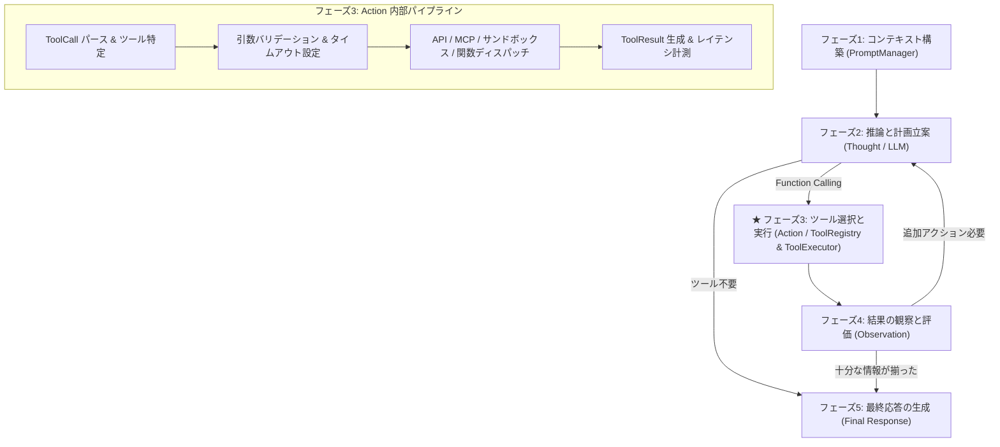

# 🛠️ Tool Registry & Action Execution (`harness.agent.tool_registry`)

Discord AI Bot における「ツールカタログ・スキーマ管理（ToolRegistry）」および「ツール選択と実行（Action / ToolExecutor）」を担当する独立ハーネスコアパッケージです。

---

## 📖 概要 (Overview)

本パッケージは、AIエージェント・ハーネスアーキテクチャの **「1-4. ツールレジストリ（フェーズ1/3に関係）」** および **「フェーズ3. ツール選択と実行（Action）」** を具現化するコンポーネントです。

LLM（推論エンジン）が外部環境と安全に干渉するための基盤として、利用可能なツールのカタログ管理、OpenAI/Ollama互換の Function Calling スキーマ生成、実処理への非同期ルーティング、タイムアウト制御、外部プロトコル（MCP / Web / 天気）連携を提供します。

### 階層ツリー構造における位置づけ

```text
AIエージェント・ハーネス（全体システム）
  1. 実行基盤（エージェント本体）
    1-1. プロンプトマネージャー(フェーズ1)＆パーサー(フェーズ2)  [harness/agent/prompt_parser]
    1-2. オーケストレーター（フロー制御 フェーズ1/2/3/4/5を制御）
    1-3. メモリマネージャー(フェーズ1/4/5に関係)
    1-4. ツールレジストリ(フェーズ1/3に関係)                      [★本パッケージ: harness/agent/tool_registry]
       ├── 利用可能なツールカタログ（スキーマ）の管理
       ├── Function Callingの実処理へのルーティング
       └── 外部プロトコル連携（MCPやOpenAPI、Web、Weather）
  2. テストハーネス（評価・安全性基盤）
```

### 主な役割
1. **ツールカタログ・スキーマ管理 (`registry.py`, `types.py`)**:
   - `ToolDefinition`, `ToolParameter` によるスキーマの厳格な型定義。
   - OpenAI / Ollama 互換の Function Calling スキーマ（`get_schemas()`）動的エクスポート。
   - カテゴリ別（WEB, MCP, WEATHER, SYSTEM, CUSTOM）やタグ別のフィルタリング、有効化/無効化制御。
2. **Action 実行・ルーティングエンジン (`executor.py`)**:
   - LLMからの `ToolCall` に対する引数バリデーション（必須パラメータ・Enumチェック）。
   - 同期・非同期（`async`）関数の透過的ディスパッチとタイムアウト制御（`asyncio.wait_for`）。
   - 多重防御・包括的例外捕捉（クラッシュを防止し `ToolResult(success=False, error=...)` を安全に返却）。
   - フェーズ4（Observation）入力用の標準フォーマット（`to_observation_message()`）。
   - 統一ログ接頭辞 `[tool_registry]` の出力と実行時間（レイテンシ）の計測。
3. **外部プロトコル・ビルトイン連携 (`adapters/`)**:
   - **Web検索アダプター (`web_search.py`)**: ネット調査・ブラウジング機能をラップ。
   - **天気情報アダプター (`weather.py`)**: 国内気象情報 MCP（気象庁 JMA & ウェザーニュース）と連携し、地域気象データ・公式予報取得機能をラップ。
   - **MCPアダプター (`mcp.py`)**: Model Context Protocol（Chrome MCP等）から動的にツールをインポート。
4. **宣言的デコレータ (`decorators.py`)**:
   - `@tool` デコレータによるPython関数の自動カタログ化・レジストリ登録。

---

## 📁 ディレクトリ構成 (Package Structure)

```text
harness/agent/tool_registry/
├── __init__.py                # 公開APIエクスポート（ToolRegistry, ToolExecutor, tool等）
├── AGENTS.md                  # 開発・運用ガイドライン（正本）
├── GEMINI.md                  # AIエージェント向けエントリポイント
├── README.md                  # 本ドキュメント
├── .agents/                   # ガイドライン・禁止事項ルールセット
│   └── rules/
│       ├── principles.md      # 設計前提・コア開発原則
│       └── ban_list.md        # バグ再発防止ナレッジ
├── types.py                   # ツール定義、パラメータ、ToolCall、ToolResult型
├── registry.py                # ツールカタログ管理（ToolRegistry）
├── executor.py                # Action実行エンジン・ルーティング（ToolExecutor）
├── decorators.py              # @tool デコレータおよびグローバルレジストリ
├── adapters/                  # 外部プロトコル・ビルトイン連携アダプター
│   ├── __init__.py
│   ├── web_search.py          # インターネット検索ツール
│   ├── weather.py             # 天気予報ツール
│   └── mcp.py                 # MCP (Model Context Protocol) 連携アダプター
└── mcp/                       # MCP クライアント・具象プロトコル連携
    ├── __init__.py            # BaseMCPClient, MCPToolInfo 等
    ├── client.py              # 汎用MCPクライアント基盤
    ├── types.py               # MCPツール型定義
    └── chrome/                # Chrome MCP 具象連携
        ├── __init__.py
        ├── xcom.py            # X (Twitter) タイムライン抽出
        ├── img2chan.py        # IMG/2ch スレッド操作
        └── img2channet_parts/ # 分割パーツ実装
```

---

## 🔄 5段階内部処理フローにおけるフェーズ3 (Action)



---

## 💻 使用方法 (Usage)

### 1. 基本的なツールの登録と実行

```python
import asyncio
from harness.agent.tool_registry import ToolRegistry, tool

# デコレータでツールを定義・自動登録
@tool(description="2つの数値を加算します")
def add_numbers(a: int, b: int) -> int:
    return a + b

async def main():
    registry = ToolRegistry()
    registry.register_function(add_numbers)

    # 1. LLM向けスキーマの取得 (フェーズ1)
    schemas = registry.get_schemas()
    # => [{"type": "function", "function": {"name": "add_numbers", ...}}]

    # 2. ツール呼び出しの実行 (フェーズ3: Action)
    result = await registry.execute("add_numbers", {"a": 10, "b": 25})
    print(result.success)  # True
    print(result.output)   # "35"
    print(result.execution_time_sec)

    # 3. Observation メッセージの生成 (フェーズ4向け)
    obs = result.to_observation_message()
    # => {"role": "tool", "name": "add_numbers", "content": "35"}

asyncio.run(main())
```

### 2. ビルトインツール（Web検索・天気）の利用

```python
from harness.agent.tool_registry import ToolRegistry, register_builtin_tools

registry = ToolRegistry()
register_builtin_tools(registry)

# search_web と get_weather が自動登録される
schemas = registry.get_schemas()
```

### 3. 国内気象情報 MCP サーバー（気象庁 & ウェザーニュース）の利用

気象庁（[jma.go.jp](https://www.jma.go.jp/jma/index.html)）の公式予報・警報・地震情報と、ウェザーニュース（[weathernews.jp](https://weathernews.jp)）のトピックス・実況解説を MCP (Model Context Protocol) 経由で取得・登録します。

```python
import asyncio
from harness.agent.tool_registry import (
    ToolRegistry,
    WeatherMCPClient,
    WeatherMCPServer,
    register_weather_mcp_tools,
)

async def main():
    registry = ToolRegistry()
    # インプロセスまたはリモートHTTP MCPサーバーに接続
    client = WeatherMCPClient(server=WeatherMCPServer())

    # 6つの国内気象ツールを自動インポート
    await register_weather_mcp_tools(registry=registry, client=client)

    # ツール実行例: 東京の天気予報を取得
    result = await registry.execute("jma_get_weather_forecast", {"area": "東京"})
    print(result.output)

    # ツール実行例: 国内気象総合レポートを取得（気象庁＆ウェザーニュース統合）
    report = await registry.execute("japan_weather_comprehensive", {"area": "大阪"})
    print(report.output)

asyncio.run(main())
```

### 4. カタログ情報の動的取得とシステムプロンプト結合 (LLM受渡準備)

登録されているツールカタログを動的に取得し、LLM（推論エンジン）向けのシステムプロンプトに結合・注入します。Markdown / XML / JSON / コンパクト形式や、ReAct / JSONブロック等のツール利用ガイドライン（プロトコル指示）に対応しています。

```python
from harness.agent.tool_registry import (
    ToolRegistry,
    SystemPromptBuilder,
    CatalogFormat,
    ToolProtocol,
)

registry = ToolRegistry()
# ... ツールやMCPツールの登録 ...

base_system_prompt = """あなたは頼れるDiscordコンパニオンです。
最新の気象情報や検索を活用してユーザーをサポートしてください。

{TOOL_CATALOG}

常に親しみやすいトーンで回答してください。"""

# 方法A: ToolRegistry の直接バインドメソッド（プレースホルダーへの動的差し込み）
llm_ready_prompt = registry.bind_to_system_prompt(
    base_system_prompt=base_system_prompt,
    format=CatalogFormat.MARKDOWN,
    protocol=ToolProtocol.JSON_CALL,
)

# 方法B: SystemPromptBuilder による流れるような構築
builder_prompt = (
    SystemPromptBuilder(base_system_prompt)
    .with_registry(registry)
    .with_format(CatalogFormat.MARKDOWN)
    .with_protocol(ToolProtocol.REACT)
    .build()
)
```

---

## 🛠️ 品質基準と規約 (Guidelines & Testing)

1. **ログ接頭辞の徹底**:
   - ツール登録、実行、タイムアウト、例外、スキーマ出力の全ログに `[tool_registry]` を付与。
2. **50KBルールの遵守**:
   - 各ソースファイルは 50KB 未満を維持。
3. **静的型検査 (mypy)**:
   - Python 3.11+ 型アノテーションを完全に付与し、エラー 0 件を維持。
   ```bash
   mypy harness/agent/tool_registry
   ```
4. **単体テストの実行**:
   ```bash
   PYTHONPATH=.:mock_libs pytest tests/test_harness_tool_registry.py
   ```
